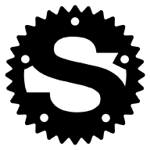

<div align="center">



# RustSecJP check

**Catch malicious, vulnerable and look-alike crates in a pull request, before you merge it.**

[](https://github.com/RustSecJP/check/actions/workflows/ci.yml)
[](https://github.com/RustSecJP/check/releases)
[](#license)

**[Product page](https://rustsecjp.github.io/check/)** · [GitHub Action](#github-action) · [Download](#download) · English · [日本語](README.ja.md)

</div>

RustSecJP check reads your `Cargo.lock` and tells you, in a comment on the pull request, if a dependency is:

- **malicious**: a crate removed from crates.io for containing malware, or a hijacked release listed in [RustSecJP/incidents](https://rustsecjp.github.io/incidents/),
- **vulnerable**: a known advisory (RUSTSEC / GHSA / CVE), with the version that fixes it,
- **unmaintained or unsound**: informational advisories,
- **a look-alike name**: one character away from a popular crate, `-rs` added, `-` swapped for `_` (a hint, not a verdict).

`Cargo.lock` is read as data only. **Nothing from your project is built or run**: no `build.rs`, no proc-macros, no `cargo` at all.

> The report is written in Japanese (RustSecJP is a Japanese-speaking community). Crate names, versions, advisory IDs and links read the same in any language, and `--format json` gives a machine-readable report.

## GitHub Action

Add `.github/workflows/rustsecjp-check.yml` to your repository:

```yaml
name: RustSecJP check
on:
  pull_request:
    paths: ["**/Cargo.lock", "**/Cargo.toml"]
permissions:
  contents: read        # read Cargo.lock through the API
  pull-requests: write  # post the result as a comment
jobs:
  check:
    runs-on: ubuntu-latest
    steps:
      - uses: RustSecJP/check@v1
        with:
          fail-on: malicious   # malicious | vulnerability | never
```

That is all. No `actions/checkout` and no Rust toolchain are needed. On every pull request that touches a lockfile, the action:

1. downloads the release binary for the runner and checks it against `SHA256SUMS`,
2. reads `Cargo.lock` from the pull request's head commit through the GitHub API,
3. posts **one** comment and updates it on later pushes, and writes the same report to the job summary,
4. fails the job if `fail-on` matches, so you can make it a required check.

`@v1` always runs the newest 1.x release. Pin `@v1.0.0` (or a commit SHA) to stay on one version.
[`examples/workflow.yml`](examples/workflow.yml) is a fuller example that also re-runs the check when a maintainer comments `@rustsecjp-bot check`.

| Input | Default | Meaning |
|---|---|---|
| `fail-on` | `malicious` | When to fail the job: `malicious`, `vulnerability` (malicious or vulnerable), or `never` |
| `lockfiles` | (all) | `Cargo.lock` paths or globs, separated by spaces or newlines. Empty means every `Cargo.lock` outside `target/` |
| `comment` | `true` | Post the result on the pull request |
| `token` | `${{ github.token }}` | Token for the comment and the API |
| `source` | `auto` | How to read `Cargo.lock`: `auto` (API for pull requests, working directory otherwise), `api`, or `workspace` |
| `working-directory` | `.` | Where to look when `source` is `workspace` |

Outputs: `result` (`ok`, `fail`, `error` or `skipped`) and `report` (path to the Markdown report).

## When you'll use it

- **A Dependabot or Renovate pull request pulls in a look-alike crate.** A version bump brings a new transitive dependency named `reqwets` or `tokio-rs`. The comment points at it, and at the popular crate it resembles, before anyone clicks merge.
- **You inherit a Rust project.** Run `rustsecjp-check` once in the repository. In a few seconds you get every vulnerable, unmaintained or malicious crate in every `Cargo.lock`, with the fixed version for each.
- **You want to block merges in CI.** Make the job a required status check with `fail-on: malicious` (or `vulnerability` for stricter projects). A pull request that adds a known-bad crate cannot be merged.
- **A new advisory comes out after a pull request was opened.** A maintainer comments `@rustsecjp-bot check` and the comment is refreshed with the latest data, without pushing a new commit.

## Download

To run it on your own machine, pick the file for your computer. These links always point to the newest release.

| OS | File |
|---|---|
| Linux (x86_64) | [`rustsecjp-check-linux-x86_64.tar.gz`](https://github.com/RustSecJP/check/releases/latest/download/rustsecjp-check-linux-x86_64.tar.gz) |
| Linux (arm64) | [`rustsecjp-check-linux-aarch64.tar.gz`](https://github.com/RustSecJP/check/releases/latest/download/rustsecjp-check-linux-aarch64.tar.gz) |
| macOS (Apple silicon) | [`rustsecjp-check-macos-aarch64.tar.gz`](https://github.com/RustSecJP/check/releases/latest/download/rustsecjp-check-macos-aarch64.tar.gz) |
| macOS (Intel) | [`rustsecjp-check-macos-x86_64.tar.gz`](https://github.com/RustSecJP/check/releases/latest/download/rustsecjp-check-macos-x86_64.tar.gz) |
| Windows (x86_64) | [`rustsecjp-check-windows-x86_64.zip`](https://github.com/RustSecJP/check/releases/latest/download/rustsecjp-check-windows-x86_64.zip) |
| Checksums | [`SHA256SUMS`](https://github.com/RustSecJP/check/releases/latest/download/SHA256SUMS) |

Check the file against `SHA256SUMS` before you use it:

```sh
sha256sum --check --ignore-missing SHA256SUMS
# macOS: shasum -a 256 --check --ignore-missing SHA256SUMS
```

The Linux binaries need glibc 2.35 or later (Ubuntu 22.04 and newer).
With Rust 1.88 or later you can also build it yourself:

```sh
cargo install --locked --git https://github.com/RustSecJP/check
```

## Usage

Run it in the project you want to check:

```sh
cd your-rust-project
rustsecjp-check                                    # every Cargo.lock below here
rustsecjp-check --fail-on vulnerability            # exit 1 on malicious or vulnerable crates
rustsecjp-check --format json --output report.json
```

| Option | Meaning |
|---|---|
| `--lockfile PATH` | `Cargo.lock` to check. Repeatable; globs and directories work. Default: every `Cargo.lock` below the current directory |
| `--format markdown\|json` | Report format |
| `--fail-on malicious\|vulnerability\|never` | When to exit with code 1 |
| `--output FILE` | Write the report to a file instead of stdout |
| `--no-osv` / `--no-incidents` / `--no-typo` | Skip one of the checks |
| `--incidents-dir DIR` | Use a local copy of RustSecJP/incidents (for offline tests) |

Exit codes: `0` nothing matched `--fail-on`, `1` `--fail-on` matched, `2` the check could not finish (for example a network error) or the options were wrong.

## What it checks

| Kind | What | Data |
|---|---|---|
| Malicious | Crates removed for containing malicious code (`MAL-*`, RustSec "malicious") | [OSV](https://osv.dev) |
| Vulnerability | Known vulnerabilities, with RUSTSEC / GHSA / CVE IDs and the fixed versions | OSV |
| Informational | Unmaintained and unsound notices | OSV |
| Look-alike name | Names close to a popular crate | Built-in list (`data/popular-crates.txt`) |
| RustSecJP records | Crates in a campaign recorded in [RustSecJP/incidents](https://rustsecjp.github.io/incidents/) | RustSecJP/incidents |

- When a RUSTSEC advisory has a Japanese translation, the report links to it.
- For a **hijacked** legitimate crate (`role = "hijacked"` in the record), only the versions in the record are malicious. When the record does not say clearly, the result is "needs review".
- A look-alike name is only a hint. It is reported when the name is one edit away from a popular name of 5+ characters (add, remove, replace, or swap two neighbours; number-only changes such as `sha1`/`sha2` are ignored), differs only in `-` vs `_`, or adds `-rs`, `-rust`, `_rs`, `_rust` or `-rst`.
- Only crates from crates.io are checked. git and path dependencies, and crates from other registries, are listed as "not checked".

## Safety and privacy

- **Nothing is built or run.** `Cargo.lock` is parsed as text. In a pull request it is fetched from the head commit through the GitHub API (`GET /repos/{owner}/{repo}/contents/...?ref=<sha>`), so a fork's `build.rs` or scripts never execute, even in `issue_comment` workflows that have a write token. Do not combine `pull_request_target` with `actions/checkout` of the fork.
- **The binary is verified.** The action uses the release that matches its own ref and checks it against `SHA256SUMS`; it stops if they differ. When pinned to a commit SHA, it only uses the release tagged at that SHA, or builds that exact source. When it has to build, it builds only the action's own code, in the action's directory, so your `.cargo/config.toml` and `rust-toolchain.toml` are not read.
- **Only names and versions leave your machine.** Crate names and versions from crates.io are sent to OSV. Source code, file paths, git/path dependencies and private registry names are never sent. RustSecJP/incidents and crates.io are only downloaded from.
- **The `@rustsecjp-bot check` command** only runs for OWNER, MEMBER or COLLABORATOR comments, so strangers cannot trigger it.

## Limitations

- Problems that are not in OSV yet are not found. A freshly removed malicious crate can take hours to days to get an advisory.
- Decisions are based on version numbers. Two different files published under the same version cannot be told apart (RustSecJP records mark such cases as "needs review").
- Look-alike names are a rough hint. Legitimate crates can show up, and look-alikes can be missed.
- Projects without a `Cargo.lock` cannot be checked.
- The code of the crates is not read: `build.rs` and proc-macro contents are not inspected.

## FAQ

<details>
<summary><b>Why does it not check out my code?</b></summary>

It does not need to. `Cargo.lock` lists every crate and version, and reading it through the API means untrusted code from a fork never touches the runner.
</details>

<details>
<summary><b>Will it comment on pull requests from forks?</b></summary>

On `pull_request`, GitHub gives fork pull requests a read-only token, so the comment may not be posted. The result is still in the job summary. A maintainer can comment `@rustsecjp-bot check` to post it (see `examples/workflow.yml`).
</details>

<details>
<summary><b>Who posts the comment?</b></summary>

`github-actions[bot]`, using `${{ github.token }}`. RustSecJP's own repositories pass the rustsecjp-bot token in `token`, so the comments show up under that name.
</details>

<details>
<summary><b>How is this different from <code>cargo audit</code> or <code>cargo deny</code>?</b></summary>

It uses the same kind of advisory data (through OSV) and adds RustSecJP's incident records and look-alike name hints. It is built around one pull-request comment that stays up to date, and it never needs your project to build.
</details>

## For developers

```sh
cargo test                                  # no network needed
cargo clippy --all-targets -- -D warnings
cargo fmt --check
cargo deny check
```

- `tests/golden/` holds the reports that the original Python version (v0.1.0) produced on the same test data. The Rust version must match them byte for byte, apart from the timestamp and the tool version.
- The list of popular crates is the top 1,000 crates.io crates by downloads, embedded in the binary. Rebuild it with `cargo run --example update-popular`. To reduce false positives, look-alike names among the next 4,000 are in `data/typo-allowlist.txt`.
- Data sources: OSV (`https://api.osv.dev/v1/querybatch` and `/v1/vulns/{id}`), and RustSecJP/incidents (downloaded from `codeload.github.com` on each run and read in memory; only names in `campaigns/*/campaign.toml` and `advisories/RUSTSEC-*.md` are used). HTTPS only; responses over 64 MiB are refused.
- `rustsecjp-check action` is the entry point for the GitHub Action. It reads its settings from `INPUT_*` and `GITHUB_*` environment variables.
- Releases: push a `vX.Y.Z` tag that matches `Cargo.toml`. The release workflow builds five binaries, publishes them with `SHA256SUMS`, and moves the major tag (`v1`).
- The product page lives in `site/` and is deployed to GitHub Pages by `.github/workflows/pages.yml`.

## About RustSecJP

[RustSecJP](https://github.com/RustSecJP) is an unofficial, Japanese-speaking community about Rust security. RustSecJP is not affiliated with the Rust Project or the Rust Foundation.

## License

Licensed under either of the MIT License ([LICENSE-MIT](LICENSE-MIT)) or the Apache License, Version 2.0 ([LICENSE-APACHE](LICENSE-APACHE)), at your option.
Copyright (c) 2026 RustSecJP contributors

Bug reports and ideas are welcome in [issues](https://github.com/RustSecJP/check/issues).
